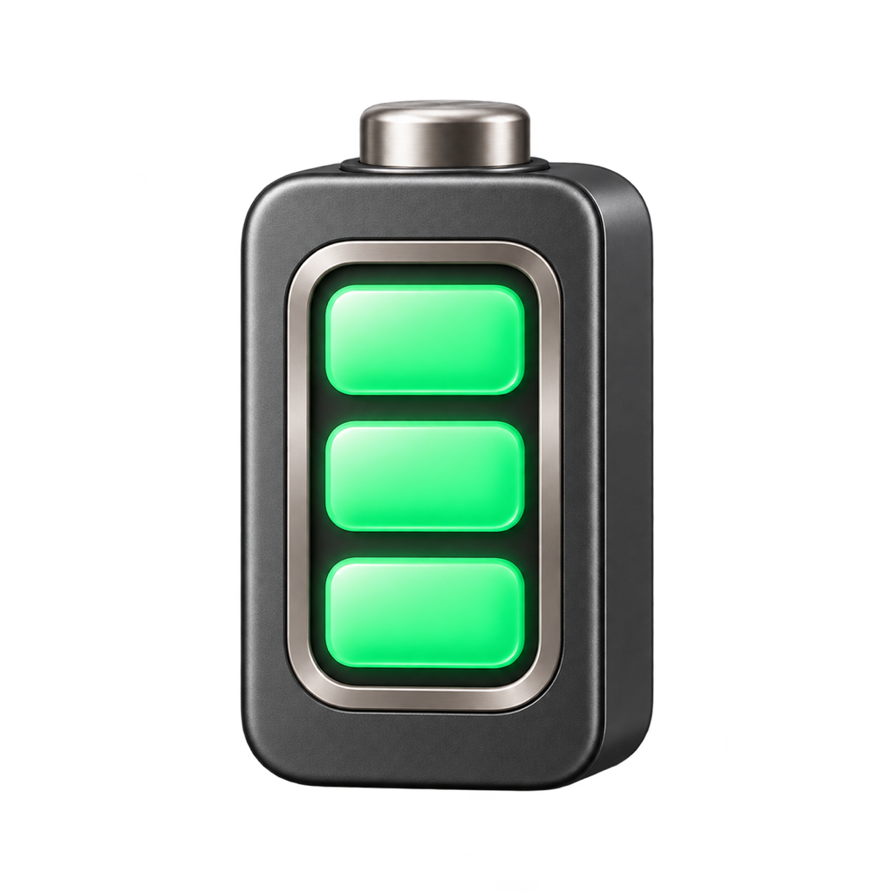

# BatteryBar



A macOS menu bar app that shows the battery level of your Bluetooth keyboard and mouse at a glance.

## Install

Download the latest `.dmg` from [Releases](https://github.com/lalalaoneplus-dev/BatteryBar/releases/latest), open it, and drag BatteryBar to Applications.

- Reads accessory power sources through IOKit and matches them to attached Bluetooth HID devices.
- Shows each device with an icon and percentage directly in the menu bar; the menu lists every device.
- Refreshes every two minutes.
- **Start at Login** toggle built on `SMAppService`.
- One Swift file, AppKit only, with zero third-party dependencies.

## Build

```sh
./build.sh
```

Builds `BatteryBar.app` into `~/Applications` and ad-hoc signs it.

Run `./package.sh` to build a universal release DMG in `dist/`.
